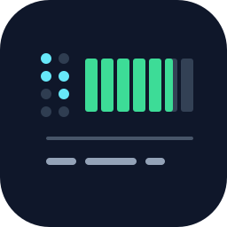
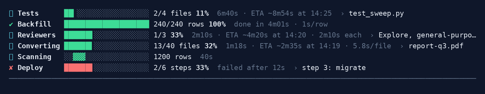

<p align="center">
  
</p>

<h1 align="center">cc-progress</h1>

<p align="center"><strong>Progress bars with an honest ETA in the Claude Code status line.</strong></p>

<p align="center">
  <a href="https://github.com/rperez93/claude-progress/actions/workflows/tests.yml"></a>
  <a href="https://pypi.org/project/cc-progress/"></a>
  <a href="https://github.com/rperez93/claude-progress/tags"></a>
  
  
  
  <br>
  <a href="https://github.com/sponsors/rperez93"></a>
</p>

A coding agent that converts forty files, runs a test sweep or migrates a table tells
you it is "working" and then goes quiet for twenty minutes. `cc-progress` puts the
answer in the status line instead: how far, how long so far, when it will finish, and
what it is on right now. The bar keeps moving while one long command runs, and the
figures are honest: an item that is running late is shown late, work that was already
done before the bar started is not counted as speed, and a workload of unequal items
is measured by its work, not by its item count.

<p align="center">
  <picture>
    <source media="(prefers-color-scheme: light)" srcset="assets/demo-light.png">
    
  </picture>
  <br>
  <sub>Real output of <code>cc-progress render</code>, drawn with the terminal's own colours. Generated by <code>assets/make-demo.py</code>.</sub>
</p>

> **Easiest install: ask your coding agent to do it.** Paste this into Claude Code:
>
> ```
> Install cc-progress from https://github.com/rperez93/claude-progress
> and follow its AGENT_INSTALL.md
> ```
>
> It installs the package, wires the status line and the hooks, checks itself with
> `cc-progress doctor`, and tells you to restart Claude Code. Prefer to do it yourself?
> See [Install](#install).

---

## Contents

- [How a bar reads](#how-a-bar-reads) · [Install](#install) · [Using it](#using-it)
- [Count work, not items](#count-work-not-items) · [Hands free](#hands-free-tasks-and-agents) · [On request](#on-request)
- [Behaviour worth knowing](#behaviour-worth-knowing) · [Configuration](#configuration) · [How it works](#how-it-works)
- [Uninstall](#uninstall) · [For agents](AGENT_INSTALL.md) · [Contributing](CONTRIBUTING.md)

---

## How a bar reads

```
⠸ Converting ██████▌░░░░░░░░░░░░░ 13/40 files 32%  1m18s · ETA ~2m35s at 12:39 · 5.8s/file  › report-q3.pdf
⠸ Tests      ██▎░░░░░░░░░░░░░░░░░ 2/4 files 11%  6m40s · ETA ~8m54s at 14:25  › test_sweep.py
⠸ Scanning   ░░▓▓▓░░░░░░░░░░░░░░░ 1200 rows  40s
⠸ Reviewers  ██████▋░░░░░░░░░░░░░ 1/3 33%  2m10s · ETA ~4m20s at 14:20 · 2m10s each  › Explore, general-purpose
✔ Backfill   ████████████████████ 240/240 rows 100%  done in 4m01s · 1s/row
✘ Deploy     ██████▋░░░░░░░░░░░░░ 2/6 steps 33%  failed after 12s  › step 3: migrate
──────────────────────────────────────────────────────────────────────────────────────────
```

One line per bar, left to right in the order the questions come:

- **Is it alive.** The spinner advances once a second. A bar that is not moving is
  visibly still being watched; a writer that has gone silent for minutes is flagged
  `no update for …` in amber.
- **How far.** The gauge is the only coloured block on the line. It fills in eighths.
  Without a total, a block sweeps back and forth instead.
- **The count**, in the unit you gave, and the percentage in bold.
- **The quiet figures.** Elapsed, then the ETA with the finish time of day once it is a
  minute away, then the measured pace. `ETA ~` is on schedule. `ETA ≥` means the current
  item is already past the average, the figure is a floor, and the time spent on that
  item follows its name in amber.
- **What it is on now**, after `›`.

A rule as wide as the widest bar closes the block, so the rows above read as progress
and the rows below as the ordinary status line. It is only drawn while a bar is shown.

Colours are the terminal's ANSI roles (green, cyan, yellow, red, bright black, bold),
never fixed values, so the bar follows whatever theme the terminal uses.

## Install

```bash
pipx install cc-progress        # or: uv tool install cc-progress
cc-progress install             # status line block, hooks, skill, rule; backs up first
cc-progress doctor              # every line should read ok
```

Then restart Claude Code: hooks and the status line are read when a session starts.

Requires `jq`, `flock` (util-linux) and bash, on Linux or macOS (WSL on Windows). Claude
Code needs a `statusLine` of type `command`; if you have none, `cc-progress install
--create-statusline` writes a minimal one showing the model and the directory, and the
bars appear above it. `statusLine.refreshInterval` is set to 1 s when unset. The whole
render takes about ten milliseconds.

From source, for working on the tool itself:

```bash
git clone https://github.com/rperez93/claude-progress.git
cd claude-progress && ./install.sh && tests/run.sh
```

## Using it

From your side there is nothing to learn. Ask for a progress bar, an ETA, or "how many
are left" on any countable job and Claude uses it; the rule installed in
`~/.claude/rules/` and the `progress-bar` skill tell it when and how. The rule that
makes it reliable: **the update is a side effect of the work**, never something to
remember between steps.

```bash
# a loop: tick inside it
cc-progress start --total "$(wc -l < files.txt)" --label Converting --unit files
while IFS= read -r f; do convert "$f"; cc-progress tick --note "$f"; done < files.txt
cc-progress done

# a command that prints one line per item: pipe it
pytest -v 2>&1 | cc-progress pipe --total 240 --label Tests --unit tests --match 'PASSED|FAILED'

# a tool that reports its own figure: set it
cc-progress set "$pct" --note "epoch $e loss $loss"
```

Parallel workers are safe: updates are locked and replaced atomically. `cc-progress
help` lists every command; `cc_progress/skill/SKILL.md` has the patterns.

## Count work, not items

The ETA is only as good as the unit. Files, tasks or steps of very unequal size make
the bar lie: a test sweep with twenty-two quick files and one of thirty minutes shows
95 % for most of the run. Pick the smallest countable thing of roughly even cost, or
keep the coarse unit for the count and give the bar the cost of each item:

```bash
for f in tests/test_*.py; do echo "$(grep -c 'def test_' "$f") $f"; done > weights.txt
cc-progress start --label Tests --unit files --weights weights.txt
for f in tests/test_*.py; do
  cc-progress note "$f"                 # the ETA now expects this file's cost
  pytest -q "$f"; cc-progress tick --item "$f"
done
cc-progress done
```

The count still reads `3/23 files`; the gauge, the percentage and the ETA are on tests.
`--weights` takes `WEIGHT NAME` lines (the shape `wc -l` prints) or a JSON object.

## Hands free: tasks and agents

```bash
cc-progress start --tasks  --label Refactor     # then create the tasks
cc-progress start --agents --label Reviewers    # then launch the agents
```

Hooks keep these in step with Claude's own task list (`TaskCreate`, `TaskUpdate`,
`TodoWrite`, and the `TaskCreated` / `TaskCompleted` events) and with subagents
(`SubagentStart` / `SubagentStop`: total = started, done = finished, note = the kinds
still running). Each hook is a few milliseconds of `jq` on a local file. Nothing is sent
to the model and nothing interrupts the conversation.

## On request

Ask Claude to *update the progress bar*, *refresh the ETA*, *what is left*, or *clear
the bars*. The skill reads the bars (`cc-progress show`), checks the source of truth,
corrects them (`set`, `total`, `note`, `done`, `fail`) and reports in one line.
`cc-progress prune` removes finished, failed and stale bars; `prune --all` removes every
bar of the session. Finished bars also leave on their own after a minute.

## Behaviour worth knowing

- **ETA.** The pace is units completed *while the bar was watching*, over the time
  between the first and the last completion (at most the last thirty). The next unit is
  expected one average interval after the last one, so the ETA counts down between
  updates. Once the current unit is overdue, the average starts counting the unit in
  flight, the ETA is shown as `≥` and grows with it: unequal items push the estimate out
  instead of pretending. No ETA without a total, before the first completion under
  observation, or before one second of data.
- **Work done before the bar started** is a baseline, not progress: `start --done N`, or
  a `set` that jumps more than one unit within two seconds of `start`, shows the count
  without feeding the pace.
- **Heartbeats are not progress.** A polling loop that re-`set`s the same value every
  few seconds is harmless: the stall check reads it, the ETA does not.
- **Finished and stalled.** A bar reaching its total counts as finished. Finished bars
  stay a minute. A running bar with no write for two minutes (or three average
  intervals, whichever is longer) is flagged; one silent for two hours is hidden. Bars
  that only hooks write are never flagged or pruned as stale.
- **Safe to call anywhere.** Updating commands exit 0 on operational errors, so progress
  reporting cannot break the job it reports on. Notes and labels are stripped of control
  characters and escape sequences. A corrupt state file degrades to one line; the other
  bars still draw.
- **Several bars** in one session have their labels aligned. Name them with `--id` and
  give each a label that says what differs.

## Configuration

Environment variables, read by the CLI and the status line:

| variable | default | effect |
|---|---|---|
| `CC_PROGRESS_DIR` | `~/.claude/progress` | where the state files live |
| `CC_PROGRESS_KEEP_DONE` | `60` | seconds a finished bar stays visible |
| `CC_PROGRESS_STALE_HIDE` | `7200` | seconds without a write before a running bar is hidden |
| `CC_PROGRESS_PRUNE_AFTER` | `600` | seconds without a write before `prune` treats a bar as stale |
| `CC_PROGRESS_MUTED` | `90` | SGR code for the quiet figures: `90` bright black, `2` faint |
| `CC_PROGRESS_ASCII` | `0` | `1` draws with `#`, `-`, `|/-\` for fonts without braille or blocks |
| `NO_COLOR` | unset | any value: plain text |
| `CC_PROGRESS_SESSION` | unset | target session when not inside Claude Code |
| `CC_PROGRESS_HOOK_LOG` | unset | a file; every hook payload is appended there (debugging) |

## How it works

- **Writers** call `cc-progress` (`start`, `tick`, `set`, `pipe`, `done`, …). Each bar is
  one JSON file at `~/.claude/progress/<session_id>/<bar>.json`, written under `flock`
  and replaced atomically, so parallel workers and a polling reader never see a torn
  file.
- **The status line** runs `cc-progress render` from a managed block in the status line
  script. With `statusLine.refreshInterval` set, Claude Code re-runs it on a timer, and
  elapsed time and ETA are computed at render time, so the bar moves during one long
  command with no messages in flight.
- **The session** comes from `$CLAUDE_CODE_SESSION_ID` on the write side and
  `session_id` in the status line's stdin on the read side. Subagents share the parent's
  id. Each session shows only its own bars; `SessionEnd` removes them.
- **The skill and the rule** tell Claude when to use it: count first, make the update a
  side effect of the work, always finish.

The tool is one bash script with `jq`; the PyPI package is a thin entry point around it
so that `pipx` can install and upgrade it. The status line and the hooks always run the
script directly.

## Uninstall

```bash
cc-progress uninstall && pipx uninstall cc-progress     # package
./install.sh --uninstall                                 # source
```

Removes the status line block, the hooks, the skill and the rule. The state directory
is left in place.

## Licence

[MIT](LICENSE).
